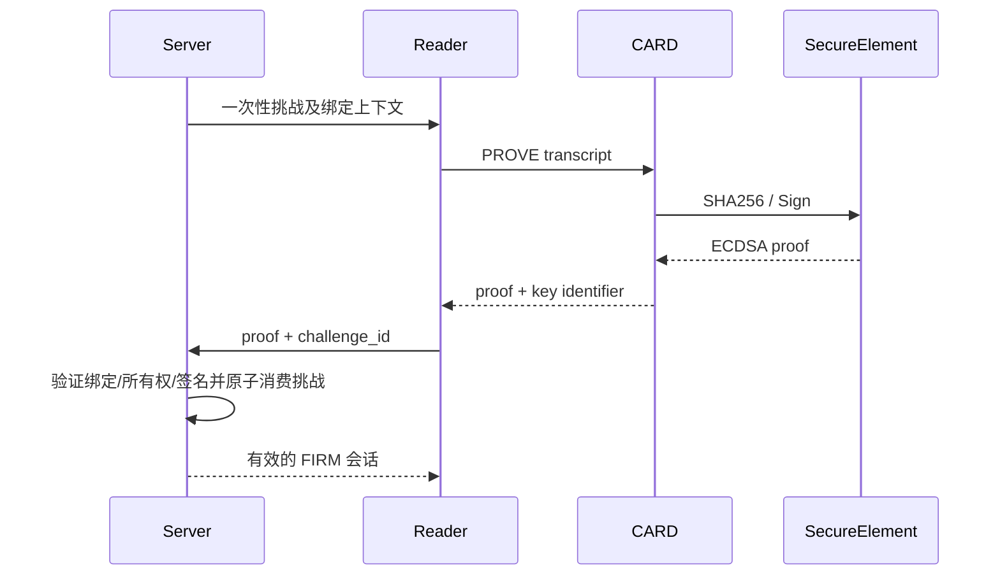

版本：0.2.0（2026-10-30）
状态：设计目标 / 审计记录；除明确证据外未实现、未仿真、未物理验证。
负责系统：CARD / READER / FPC / Server。
依赖：锁定源码 SHA、外部安全器件选型、平台权限。
验证标准：下述验收条款逐项提供可复现证据。
已知风险：旧版认证不安全；平台未提交；封装未确认。

# 安全认证目标
采用支持不可导出逐卡 P-256 私钥及 ECDSA/SHA-256 的成熟安全器件候选，具体料号、SPI/I2C 接口和制造供应链未确认；若选 I2C，必须先实现/验证 I2C 控制器，不能宣称现有 SPI 已兼容。
私钥在器件内部生成，个性化站登记公钥、证书链/器件标识及 UID，制造审计后锁配置。不得将根密钥/服务器主密钥写进 RTL。TT SKY130 数字逻辑本身未提供已验证的安全 NVM。
服务端签发32字节 CSPRNG nonce、challenge_id、有效期60s、account_id、SteamID、card_record_id、audience；构造下述固定宽度规范二进制 transcript，SHA-256 后器件签名。此编码为候选v1；签名/安全器件互通仍待验证。

Reader pass 不作为服务器信任根。不存在安全器件、未个性化或验证失败时 fail closed。公开 v1 测试算法保持标注，不可用作替代。

## 候选transcript v1（Python编码已测试，RTL/后端未集成）
总长123字节，落在拟议v2帧128字节payload预算内。顺序固定：domain=ASCII FIRM-CARD-PROOF+NUL(16)；version=01(1)；key_id(8)；challenge_id(16)；nonce(32)；account_id UUID原始字节(16)；SteamID uint64BE(8)；UID ASCII十进制保留前导零(10)；AppID uint32BE(4)；audience_id uint32BE(4)；expires_at UTC Unix秒uint64BE(8)。每字段长度固定，无JSON、Unicode正规化或隐式数值字符串转换。版本升级必须重新分配版本号，不静默改变布局。
key_id仅8字节查找标识，服务器登记必须唯一并绑定完整公钥/证书；不能把截短标识当安全凭证。UID也不是凭证。audience_id由服务器注册表分离生产/测试，AppID与经Steam验证的所有权一致。有效期策略由服务器记录创建时间，最多60s；不得相信客户端时钟或仅根据过期字段授予权限。
签名目标为SHA256(全部123字节)，候选算法ECDSA P-256，线格式固定r(32BE)||s(32BE)，服务器使用成熟库验证；候选线格式要求low-S；DER转换在主机侧规范化s=min(s,n-s)，验签侧拒绝非规范high-S。真实器件及驱动仍待互通验证。响应建议status(1)+key_id(8)+signature(64)=73字节。签名格式只是规格，没有实现ECDSA或伪造签名结果。
如果器件只支持签预哈希，哈希可能由Reader计算，但服务器必须从自己保存的挑战/Steam/账号/卡片/用途数据重建123字节并独立计算摘要，不能验客户端任意摘要后登录。专用逐卡密钥不得跨协议复用；签名成功并不自动消费挑战，服务器原子单次消费与绑定/撤销检查仍是必须条件。
参考auth_transcript.py只编码和哈希，不产生nonce、不签名、不验签、不授权；示例nonce全部为测试数据。参考向量已用hashlib和OpenSSL分别计算SHA256比对，见deliverables/auth-transcript-vector.json。

## 软件参考互通（不代表安全芯片验证）
proof_signature.py使用cryptography库的P-256、ECDSA Prehashed(SHA256)和DER编码工具，不自行实现椭圆曲线算法。参考接收端限定P-256、64字节raw及有效r/s范围，要求low-S；只校验服务器重建挑战的签名。设备DER签名可由主机规范化为raw，不改变有效性。
当前互通实验：cryptography50.0.0生成内存临时测试密钥，签摘要；OpenSSL3.5.7对原始123字节transcript做一次SHA256后验签成功。错误公钥/曲线、修改nonce/UID/AppID/audience、高S、标量0/越界、错误DER、重复哈希签名均有拒绝测试。测试不导出私钥、不生成生产个性化材料，OpenSSL与cryptography共享底层技术，不能称独立算法认证。
运行完整参考测试前安装requirements-reference.txt；CI已新增安装步骤，但远程CI尚未运行。验签通过不能绕过Steam所有权、挑战期限/单次消费、卡片状态和账号绑定检查。此模块不是后端认证服务，更没有改变CARD/READER原型RTL的公开XOR/Rotate。
